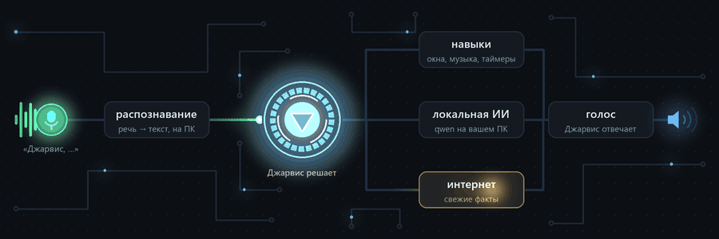

<div align="center">


# Джарвис

**Голосовой ассистент для Windows, который звучит как J.A.R.V.I.S. и думает на вашем компьютере**

<sub>A Russian-speaking J.A.R.V.I.S. for Windows: local speech recognition, a local LLM, the iconic voice.</sub>

<br>

[](#-установка-за-3-шага)
[](#-для-разработчиков)
[](#-что-он-умеет)
[](https://github.com/N1ck6/Your-Jarvis-Assistant/commits/main)
[](LICENSE.txt)

<br>



<br><br>

[](https://github.com/N1ck6/Your-Jarvis-Assistant/archive/refs/heads/main.zip)
&nbsp;
[](https://n1ck6.github.io/Your-Jarvis-Assistant/)
&nbsp;
[](COMMANDS.md)

</div>

<br>

> «Джарвис, открой телеграм» · «Джарвис, напомни через 15 минут выключить плиту» · «Джарвис, включи что-нибудь
> спокойное» · «Джарвис, когда будет следующий дождь?» · «Джарвис, найди на озоне наушники до 3000 с хорошими
> отзывами» · «Джарвис, объясни подробно, что такое DNS»

Говорите «Джарвис, …» — он отвечает голосом Джарвиса и управляет компьютером. Речь распознаётся и понимается
**прямо на вашем ПК**: без подписок, без отправки разговоров на чужие серверы. Облако (бесплатные Groq и Gemini)
нужно только для свежих фактов из интернета.

## ✨ Что он умеет

<table>
<tr>
<td width="33%" valign="top">

### 🎙️ Тот самый голос
Узнаваемый тембр Джарвиса, ~0,1 с на фразу — даже без видеокарты. С NVIDIA — полный клон голоса.

</td>
<td width="33%" valign="top">

### 🧠 ИИ на вашем ПК
Локальная модель понимает свободные фразы: не нужно учить команды. Новые формулировки он запоминает.

</td>
<td width="33%" valign="top">

### ⚡ Можно перебивать
Говорите поверх ответа: он стихает и слушает. Эхоподавление не даёт ему услышать самого себя.

</td>
</tr>
<tr>
<td valign="top">

### 🌐 Агент в браузере
Найдёт товар на Озоне, включит видео на YouTube, проследит за ценой. Покупка и отправка — только после вашего «да».

</td>
<td valign="top">

### ✍️ Диктовка где угодно
<kbd>Ctrl</kbd>+<kbd>Alt</kbd>+<kbd>D</kbd> — и текст печатается там, где курсор: в браузере, мессенджере, редакторе.

</td>
<td valign="top">

### 🖥️ Помощь с экраном
Выделите область: объяснит ошибку, решит задачу по шагам, скопирует текст с картинки.

</td>
</tr>
<tr>
<td valign="top">

### 🎵 Музыка и звук
Треки из вашей папки по названию, плейлисты, громкость отдельных программ: «сделай дискорд тише».

</td>
<td valign="top">

### ⏰ Таймеры и дела
Напоминания, будильники, помодоро, списки покупок, календарь и утренняя сводка на «доброе утро».

</td>
<td valign="top">

### 📚 Объясняет наглядно
Карточки с формулами, графики функций, молекулы и картинки — пока голос рассказывает главное.

</td>
</tr>
<tr>
<td valign="top">

### 🧩 Свои команды
Сценарии «фраза → действия» собираются кнопками в настройках. Навыки — папка с кодом, подхватываются сами.

</td>
<td valign="top">

### 🔒 Под вашим контролем
Не трогает пароли, платежи и чужие файлы; читает только разрешённые папки. Опасное — с подтверждением.

</td>
<td valign="top">

### 🔄 Обновляется незаметно
Новая версия загружается рядом и принимает работу за секунду — вы даже не заметите перезапуска.

</td>
</tr>
</table>

## 🚀 Установка за 3 шага

1. **Скачайте** — [ZIP-архив](https://github.com/N1ck6/Your-Jarvis-Assistant/archive/refs/heads/main.zip) или
   `git clone https://github.com/N1ck6/Your-Jarvis-Assistant.git`.
2. **Запустите `install.bat`** — он сам поставит всё недостающее и скачает модели (15–40 минут; если прервётся,
   запустите ещё раз — скачанное не потеряется).
3. **Запустите `run.bat`** — Джарвис появится в трее и поприветствует вас.

<div align="center">
<sub>Джарвис обновляется почти каждый день: новые навыки, ускорения, голос всё живее.<br>
⭐ в правом верхнем углу — и он не потеряется среди ваших проектов, когда выйдет следующая версия.</sub>
</div>

<br>

<details>
<summary><b>💻 Что нужно компьютеру</b></summary>
<br>

| | |
|---|---|
| Система | Windows 10/11, 64 бит, микрофон |
| Память | 16 ГБ ОЗУ (8 ГБ — без локальной модели, см. `-NoOllama`) |
| Диск | ~15 ГБ: программа и модели ~5 ГБ, локальная модель ИИ ~8 ГБ |
| Видеокарта | не обязательна: голос Джарвиса по умолчанию работает на процессоре. NVIDIA с 6+ ГБ ускоряет ИИ |

Установщик сам ставит (через winget или с официальных сайтов, если чего-то нет):
Python 3.12, Microsoft Visual C++ Runtime, [Ollama](https://ollama.com) с моделями `qwen3:8b` и
`qwen3-vl:4b-instruct`, библиотеки Python в папку `.venv` проекта, модели речи (~600 МБ).
**Голос** по умолчанию — «Джарвис Lite» (`models/piper`, входит в репозиторий): голос Джарвиса, ~0,1 с на фразу
на процессоре. Если найдена видеокарта NVIDIA, установщик предложит полный клон голоса (~5 ГБ, чуть живее).

Параметры `install.bat`: `-JarvisVoice` (клон голоса без вопроса), `-NoJarvisVoice`, `-NoOllama`
(без локальной модели — тогда нужны ключи ниже). `run.bat` на новом компьютере сам запускает установку.

</details>

<details>
<summary><b>🔑 Ключи для свежих новостей и фактов (необязательно)</b></summary>
<br>

Бесплатные, вписываются в трее: **Настройки → ИИ** (или в файл `.env`). Из России нужен VPN.

- `GROQ_API_KEY` — https://console.groq.com/keys (ответы с поиском в интернете)
- `GEMINI_API_KEY` — https://aistudio.google.com/apikey (знания, помощь с экраном)

Без ключей работает всё, кроме ответов о свежих событиях.

</details>

## 🗣️ Как с ним говорить

- **«Джарвис, …»** и команда. Только «Джарвис» — ответит «Да, сэр» и подождёт.
- **Перебить** можно в любой момент: «Джарвис, …» или «стоп / хватит / подожди». Пока вы говорите поверх, он
  становится тише — команда не теряется.
- **8 секунд после ответа** можно продолжать без имени: «а завтра?», «ещё громче».
- **«не то»** — отменить последнее действие, **«верни как было»** — откатить изменение,
  **«не то, я имел в виду …»** — сделать прошлый запрос заново с поправкой.
- **«какой был мой прошлый запрос?»**, «а до этого?», **«а если …»**, «то же самое, но …» — он помнит разговор.

| Клавиши | |
|---|---|
| <kbd>Ctrl</kbd>+<kbd>Alt</kbd>+<kbd>J</kbd> | слушать без кодового слова |
| <kbd>Ctrl</kbd>+<kbd>Alt</kbd>+<kbd>D</kbd> | диктовка: текст печатается по фразам там, где курсор; ещё раз — стоп |
| <kbd>Ctrl</kbd>+<kbd>Alt</kbd>+<kbd>S</kbd> | помощь с экраном: выделите область |
| <kbd>Ctrl</kbd>+<kbd>Alt</kbd>+<kbd>K</kbd> | выключить / включить микрофон |

**Трей**: щелчок — слушать, ещё щелчок, пока он слушает или думает, — отменить. Меню — чат с Джарвисом текстом,
микрофон, настройки, выход. Все команды с примерами — в **[COMMANDS.md](COMMANDS.md)**.

## 🌐 Агент в браузере

Джарвис выполняет задачи на сайтах в вашем браузере (Яндекс Браузер, Chrome, Edge) — с вашими аккаунтами, в
отдельной вкладке «Джарвис»: ваша остаётся впереди, а на его вкладке видно, что он делает. Ответ — голосом и
карточкой со ссылками.

```
«Джарвис, найди на озоне наушники до 3000 с хорошими отзывами»   «Джарвис, включи на ютубе обзор RTX 5070»
«Джарвис, перескажи эту статью» / «о чём это видео»              «Джарвис, покажи браузер»
«Джарвис, каждый день в 9 проверяй цену на AirPods на озоне и скажи, если подешевеют»
```

| ✅ Сам | 🤝 Только после вашего «да» | ⛔ Никогда |
|---|---|---|
| ищет, читает, сравнивает, фильтры и сортировка, корзина и избранное, обычные поля, включает видео | оформление заказа, оплата сохранённой картой, отправка форм, сообщений и отзывов, публикация, подписки, удаление, настройки аккаунта | пароли, коды из СМС, данные карт и паспорта, капча, переводы денег, банки, Госуслуги, криптовалюта, принятие условий |

<details>
<summary><b>Как подключить (один раз)</b></summary>
<br>

«Джарвис, подключи браузер» — откроется папка `browser_extension` (путь — в буфере обмена).
В браузере: `browser://extensions` (в Chrome — `chrome://extensions`) → «Режим разработчика» → «Загрузить
распакованное расширение» → эта папка. Значок «Джарвис» на панели без надписи «off» — связь есть; щелчок по нему —
то же, что сказать «Джарвис».

На капче или входе в аккаунт окно выходит вперёд, Джарвис просит пройти их и продолжает сам. Текст сайтов для
агента — данные, а не команды. Связь — только с этого компьютера и только с этим расширением (ключ связи Джарвис
создаёт сам, в git он не попадает). План и чтение страниц — Gemini Flash, рутинные шаги — локальная модель.

</details>

## ⚙️ Настройки

**Трей → Настройки** или «Джарвис, открой настройки»: город, голос, папки, микрофон и динамики, горячие клавиши,
модели ИИ, ключи, автозапуск. Применяются сразу.

- **Сценарии** «фраза → действия» — редактор с кнопками ([как выглядят в файле](COMMANDS.md#свои-сценарии)).
- **История запросов** — «Сохранять историю запросов»: запрос, как он понят, и ответ (`data/history.jsonl`);
  «не то» помечает ошибку, в разделе «История» — просмотр и пометки. Разговор переживает перезапуск.
- **Свои навыки** — папка `data/skills/<id>/` с манифестом, фразами и кодом, формат — в [SKILLS.md](SKILLS.md).
- Свои значения хранятся в `data/settings.json`, все параметры с описанием — в `config/default.toml`.

<details>
<summary><b>🛠️ Если что-то не так</b></summary>
<br>

| Проблема | Решение |
|---|---|
| Не реагирует на «Джарвис» | Параметры Windows → Конфиденциальность → Микрофон: разрешить доступ классическим приложениям. Проверьте микрофон в Настройки → Микрофон и звук. |
| Не понимает свободные фразы, не отвечает на вопросы | Не запущена Ollama: запустите её из меню «Пуск» (Джарвис подхватит сам через 30 с) или `install.bat` ещё раз. |
| Не отвечает о новостях и курсах | Нужен ключ Groq или Gemini (и VPN из России). |
| Тихо / громко говорит | «говори громче / тише» или Настройки → Голос. |
| Bluetooth-наушники звучат как в звонке, громкость не меняется | Джарвис не берёт микрофон наушников, если есть другой. Если других нет — выберите микрофон в Настройки → Микрофон и звук или подключите отдельный. |
| Не слышит «Джарвис» посреди ответа | Динамики слишком громко и близко к микрофону: убавьте громкость или используйте наушники. |
| Что-то сломалось | `run_console.bat` покажет журнал; он же в `data/logs/assistant.log`. |

**Обновление**: `git pull`, затем `install.bat` (докачает новое). Запущенный Джарвис сам замечает новый коммит и
тихо перезапускается, когда свободен (отключается в Настройках → «Перезапускаться после обновления кода»).
**Удаление**: удалите папку проекта и модели Ollama (`ollama rm qwen3:8b qwen3-vl:4b-instruct`); кэш моделей
речи — `%USERPROFILE%\.cache\huggingface`.

</details>

## 👩‍💻 Для разработчиков

<details>
<summary><b>Запуск, тесты, устройство</b></summary>
<br>

```powershell
.venv\Scripts\python -m pytest                       # ~770 тестов: формулировки команд, речь, интерфейс
.venv\Scripts\python -m assistant --text             # запросы текстом, без микрофона
.venv\Scripts\python -m assistant --list-devices     # аудиоустройства
powershell -ExecutionPolicy Bypass -File scripts\build.ps1   # сборка dist\Jarvis (PyInstaller)
.venv\Scripts\python scripts\readme_gif.py           # анимация в начале этой страницы
```

**Как он устроен** (то, что на анимации): Silero VAD + Vosk слышат «Джарвис» → GigaAM v3 переводит речь в
текст → маршрутизатор (готовые фразы модулей, выученные формулировки, локальная `qwen3:8b`) решает, что делать →
навык, локальная модель или поиск через Groq / Gemini → голос: Piper «Джарвис Lite» / ESpeech-TTS-1 / Silero.
Интерфейс — PySide6 (трей и окна), страница настроек — FastAPI.

Код — в `assistant/`: `app.py` (точка входа), `assistant.py` (микрофон → речь → ответ), `brain.py` и `router.py`
(понимание фраз), `skills/` (модули команд), `tts/`, `audio/`, `llm/`, `ui/`. Свой модуль: файл в
`assistant/skills/`, имя в `[skills] enabled` (`config/default.toml`), формулировки в `tests/test_skills.py`.

</details>

<details>
<summary><b>📜 Лицензии</b></summary>
<br>

Код — MIT. Модели со своими лицензиями, скачиваются при установке и в репозиторий не входят: реплики Джарвиса
из проекта [Priler/jarvis](https://github.com/Priler/jarvis), Silero TTS и голос «Джарвис Lite» (обучен на синтезе
клона по этим репликам, от голоса Piper ruslan) — CC BY-NC-SA 4.0 (только некоммерческое использование),
ESpeech-TTS-1 — Apache 2.0, GigaAM — MIT, Vosk — Apache 2.0, Silero Stress — MIT, WeSpeaker — Apache 2.0,
словарь CMU — BSD.

</details>

<br>

<div align="center">


**«К вашим услугам, сэр.»**

<sub>Если Джарвис прижился у вас на компьютере — звезда ⭐ подскажет, что проект стоит развивать дальше,<br>
а вам будет проще вернуться за новыми навыками.</sub>

</div>
